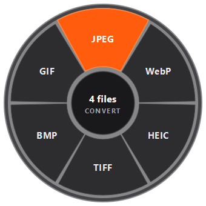
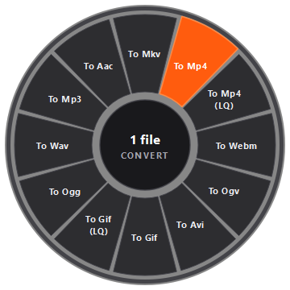
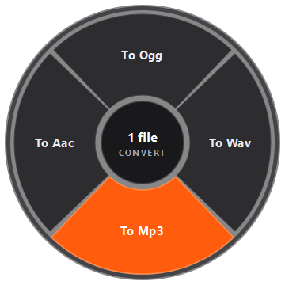

# Tangerine for Windows 🍊

> **Drag. Hold Shift. Drop. Converted in 1 second.**  
> Recreación de la famosa app de macOS **Tangerine** ahora para **Windows 10 y Windows 11**.



Sin abrir páginas web, sin abrir ventanas pesadas ni pulsar botones de confirmación: simplemente arrastra tus archivos con la tecla **Shift** presionada y suelta sobre el formato deseado.

---

## ✨ Características

- 🎯 **Gesto Universal Shift + Drag**: Funciona en cualquier parte de Windows (Escritorio, Explorador de archivos, etc.).
- 🤫 **100% Silencioso**: No interrumpe con notificaciones emergentes; el archivo resultante aparece inmediatamente junto al original en milisegundos.
- 🖼️ **Imágenes**: JPG, PNG, WebP, GIF, BMP, TIFF, HEIC/HEIF, ICO, PDF.
- 🎵 **Audios**: To Ogg, To Wav, To Mp3, To Aac.
- 🎬 **Videos**: To Mkv, To Mp4, To Mp4 (Low Quality), To Webm, To Ogv, To Avi, To Gif, To Gif (Low Quality), y extracción de audio a Ogg, Wav, Mp3, Aac.
- 📄 **Documentos**: Extrae páginas de PDF a imágenes individuales al instante.
- 🏎️ **Súper Rápido y Ligero**: Procesamiento local con aceleración FFmpeg y Pillow. Cero llamadas a servidores externos.
- 🎛️ **Icono en la Bandeja del Sistema**: Cambia la tecla disparadora (`Shift`, `Ctrl`, `Alt`) o pausa la detección cuando quieras.

---

## 📸 Vistas Previas

| Imágenes (8 formatos) | Videos (12 formatos) | Audios (4 formatos) |
| :---: | :---: | :---: |
|  |  |  |

---

## 🚀 Instalación y Uso Rápido

### Requisitos
- **Python 3.10+** instalado en Windows.

### 1. Clonar o descargar el repositorio
```bash
git clone https://github.com/TU_USUARIO/tangerine-windows.git
cd tangerine-windows
```

### 2. Instalar dependencias
```bash
pip install -r requirements.txt
```

### 3. Iniciar la aplicación
- **Opción A (Silencioso en segundo plano)**:
  Doble clic en `iniciar_tangerine_silencioso.vbs`. Se abrirá directamente en la bandeja del sistema junto al reloj.
- **Opción B (Con consola de seguimiento)**:
  Doble clic en `iniciar_tangerine.bat` o:
  ```bash
  python run.py
  ```

---

## 📦 ¿Cómo crear un Ejecutable `.exe` independiente?

Si quieres generar un archivo `.exe` para compartirlo o usarlo sin tener Python abierto:

```bash
pip install pyinstaller
pyinstaller --noconsole --onefile --name "Tangerine" run.py
```
El ejecutable se generará en la carpeta `dist/Tangerine.exe`.

---

## 🛠️ Tecnologías

- **GUI & Gráficos**: PySide6 (Qt para Python) con renderizado vectorial por hardware vía `QPainter`.
- **Detección Global**: Win32 API (`GetAsyncKeyState`) sin necesidad de permisos de Administrador.
- **Procesamiento Multimedia**: Pillow, Pillow-HEIF, PyMuPDF y FFmpeg (vía `imageio-ffmpeg`).

---

## 📄 Licencia

Distribuido bajo la licencia MIT. Creado para la comunidad.
