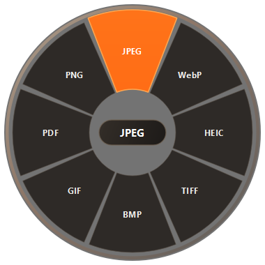
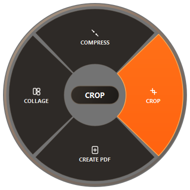
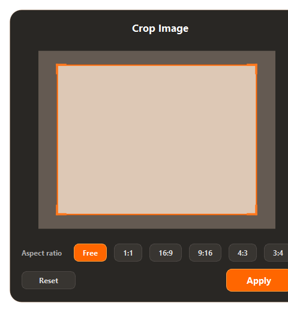

# Tangerine for Windows 🍊

> **Drag. Hold Shift. Drop. Converted in 1 second.**  
> Recreación avanzada de la famosa app de macOS **Tangerine** ahora para **Windows 10 y Windows 11**.



Sin abrir páginas web, sin abrir ventanas pesadas ni pulsar botones de confirmación: simplemente arrastra tus archivos con la tecla **Shift** presionada y suelta sobre el formato deseado.

---

## ✨ Novedades y Características

- 🎯 **Gesto Universal Shift + Drag**: Funciona en cualquier parte de Windows (Escritorio, Explorador de archivos, etc.).
- 💎 **Diseño Glassmorphism & Plus Jakarta Sans**: Acabado de vidrio esmerilado con brillo ámbar, bordes especulares y tipografía moderna Plus Jakarta Sans.
- 💊 **Cápsula Central Dinámica**: Al mover el ratón sobre cualquier gajo, el centro muestra dinámicamente el formato elegido o el peso exacto (`1.2 MB`, `JPG`, `CROP`).
- 🔄 **Sub-Menús Radiales Inteligentes**:
  - Al mantener el cursor quieto sobre **PDF**, se abre el submenú de herramientas: **COMPRESS**, **CROP**, **CREATE PDF**, **COLLAGE**.
  - Al mantener el cursor sobre formatos de imagen (como **TIFF** o **JPEG**), se despliega el menú de herramientas avanzadas con iconos vectoriales minimalistas.
- ✂️ **Ventana de Ajuste Crop Image**: Ventana interactiva de recorte con proporciones (*Free, 1:1, 16:9, 9:16, 4:3, 3:4*) y botón Apply en Naranja Tangerine.
- 🤫 **100% Silencioso**: No interrumpe con notificaciones emergentes de Windows. El archivo procesado aparece inmediatamente junto al original.
- 🎬 **Soporte Multimedia Total**:
  - **Imágenes**: JPG, PNG, WebP, GIF, BMP, TIFF, HEIC/HEIF, ICO, PDF.
  - **Audios**: To Ogg, To Wav, To Mp3, To Aac.
  - **Videos (12 formatos)**: To Mkv, To Mp4, To Mp4 (Low Quality), To Webm, To Ogv, To Avi, To Gif, To Gif (Low Quality), y extracción de audio a Ogg, Wav, Mp3, Aac.

---

## 📸 Vistas Previas

| Menú Principal Glassmorphic | Sub-Menú Herramientas (Iconos) | Ventana Crop Image Dialog |
| :---: | :---: | :---: |
|  |  |  |

---

## 🚀 Instalación y Uso Rápido

### Requisitos
- **Python 3.10+** instalado en Windows.

### 1. Clonar o descargar el repositorio
```bash
git clone https://github.com/TU_USUARIO/tangerine-windows.git
cd tangerine-windows
```

### 2. Instalar dependencias
```bash
pip install -r requirements.txt
```

### 3. Iniciar la aplicación
- **Modo Silencioso (en segundo plano)**:
  Doble clic en `iniciar_tangerine_silencioso.vbs`. Se abrirá en la bandeja del sistema junto al reloj.
- **Modo Interactivo**:
  Doble clic en `iniciar_tangerine.bat` o:
  ```bash
  python run.py
  ```

---

## 📦 ¿Cómo crear un Ejecutable `.exe` independiente?

Para generar un archivo `.exe` y usarlo sin necesidad de abrir Python:

```bash
pip install pyinstaller
pyinstaller --noconsole --onefile --name "Tangerine" run.py
```
El ejecutable se creará en la carpeta `dist/Tangerine.exe`.

---

## 🛠️ Tecnologías

- **GUI & Gráficos**: PySide6 (Qt para Python) con renderizado vectorial por hardware vía `QPainter`.
- **Detección Global**: Win32 API (`GetAsyncKeyState`) sin necesidad de permisos de Administrador.
- **Tipografía**: Plus Jakarta Sans integrada.
- **Motor Multimedia**: Pillow, Pillow-HEIF, PyMuPDF y FFmpeg (vía `imageio-ffmpeg`).

---

## 📄 Licencia

Distribuido bajo la licencia MIT. Creado para la comunidad.
