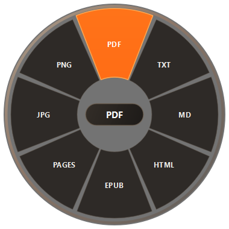
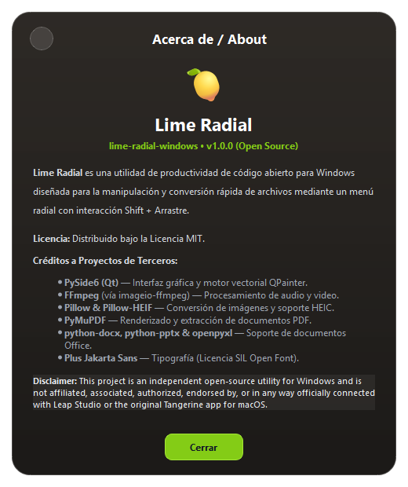

# Lime Radial (lime-radial-windows) 🍋

> **Drag. Hold Shift. Drop. Converted in 1 second.**  
> Utilidad open-source de productividad para Windows con interacción mediante menú radial fluido al arrastrar archivos.


Sin abrir páginas web, sin ventanas pesadas ni confirmaciones molestas: simplemente arrastra tus archivos en Windows manteniendo presionada la tecla **Shift** y suelta sobre el formato o herramienta deseada.

---

## ✨ Características Principales

- 🎯 **Gesto Universal Shift + Drag Inteligente**: Funciona en cualquier parte de Windows (Escritorio, Explorador de archivos, etc.). **Protegido contra falsos positivos en juegos, navegadores y otras aplicaciones**.
- 📑 **Documentos de Office (Word, Excel, PowerPoint)**:
  - Soporta `.docx`, `.doc`, `.xlsx`, `.xls`, `.csv`, `.pptx`, `.ppt`.
  - Formatos destino disponibles: **PDF, TXT, MD, HTML, EPUB, PAGES, JPG, PNG**.
- 💎 **Diseño Glassmorphism & Plus Jakarta Sans**: Acabado de vidrio esmerilado con brillo ámbar, bordes especulares y tipografía moderna Plus Jakarta Sans integrada.
- 💊 **Cápsula Central Dinámica**: Al mover el ratón sobre cualquier gajo, el centro muestra dinámicamente el formato elegido o el peso exacto (`1.2 MB`, `JPG`, `CROP`).
- 🔄 **Sub-Menús Radiales Inteligentes (Dwell Time)**:
  - Al mantener el cursor quieto sobre **PDF**, se despliega el submenú de herramientas: **COMPRESS**, **CROP**, **CREATE PDF**, **COLLAGE**.
  - Al posarse sobre formatos de imagen (como **TIFF** o **JPEG**), se despliega el menú de herramientas avanzadas con iconos vectoriales minimalistas.
- ✂️ **Ventana de Recorte Profesional (Crop Image)**:
  - Recorte manual interactivo arrastrando esquinas, bordes o el recuadro libre.
  - Dimensiones **W y H calculadas en PX en tiempo real** (con edición manual para medidas exactas).
  - Selector de relación de aspecto (*Free, 1:1, 16:9, 9:16, 4:3, 3:4*).
  - Botón circular de cierre `✕` y estética Glassmorphism cálida.
- 🛠️ **Suite de Herramientas de Edición**:
  - **Edit**: Ajustes en vivo de brillo, contraste, saturación, rotación 90° y volteo horizontal.
  - **Add BG**: Añade fondos elegantes acolchados con degradados y bordes redondeados.
  - **Redact**: Censura interactiva arrastrando cajas negras sobre datos privados.
  - **Annotate**: Lienzo para dibujar notas y flechas sobre la imagen.
  - **Compress, Create PDF, Collage, Metadata Strip**.
- 🤫 **100% Silencioso**: No interrumpe con notificaciones emergentes. El archivo procesado aparece inmediatamente junto al original.
- 🎬 **Soporte Multimedia**:
  - **Imágenes**: JPG, PNG, WebP, GIF, BMP, TIFF, HEIC/HEIF, ICO, PDF.
  - **Audios**: To Ogg, To Wav, To Mp3, To Aac.
  - **Videos (12 formatos)**: To Mkv, To Mp4, To Mp4 (Low Quality), To Webm, To Ogv, To Avi, To Gif, To Gif (Low Quality), y extracción de audio a Ogg, Wav, Mp3, Aac.

---

## 📸 Vistas Previas

| Menú Radial Glassmorphic | Documentos Office | Ventana Crop con PX | Ventana Acerca de / About |
| :---: | :---: | :---: | :---: |
|  |  |  |  |

---

## 🚀 Instalación y Uso

### Requisitos
- **Windows 10 o Windows 11**.
- **Python 3.10+** instalado.

### 1. Clonar el repositorio
```bash
git clone https://github.com/JrHector30/tangerine-windows.git lime-radial-windows
cd lime-radial-windows
```

### 2. Instalar dependencias
```bash
pip install -r requirements.txt
```

### 3. Iniciar la aplicación
- **Modo Silencioso (en segundo plano)**:
  Doble clic en `iniciar_lime_silencioso.vbs`. Se colocará silenciosamente en la bandeja del sistema junto al reloj.
- **Modo Interactivo (con consola)**:
  Doble clic en `iniciar_lime.bat` o:
  ```bash
  python run.py
  ```

---

## 📦 Generar Ejecutable `.exe` Independiente

Para empaquetar Lime Radial como un único archivo `.exe` sin necesidad de ejecutar Python:

```bash
pip install pyinstaller
pyinstaller --noconsole --onefile --name "LimeRadial" run.py
```
El ejecutable se creará en la carpeta `dist/LimeRadial.exe`.

---

## 🛠️ Tecnologías y Créditos a Terceros

- **GUI & Gráficos**: [PySide6 (Qt para Python)](https://www.qt.io/) con renderizado vectorial por hardware vía `QPainter`.
- **Detección Global**: Win32 API (`GetAsyncKeyState`, `WindowFromPoint`) sin necesidad de permisos de Administrador.
- **Tipografía**: [Plus Jakarta Sans](https://fonts.google.com/specimen/Plus+Jakarta+Sans) (SIL Open Font License).
- **Multimedia y Documentos**: Pillow, Pillow-HEIF, PyMuPDF, FFmpeg (vía `imageio-ffmpeg`), python-docx, python-pptx y openpyxl.

---

## 📄 Licencia

Distribuido bajo la **Licencia MIT**. Proyecto abierto para la comunidad.

---

## ⚠️ Disclaimer

**Disclaimer:** This project is an independent open-source utility for Windows and is not affiliated, associated, authorized, endorsed by, or in any way officially connected with Leap Studio or the original Tangerine app for macOS.
